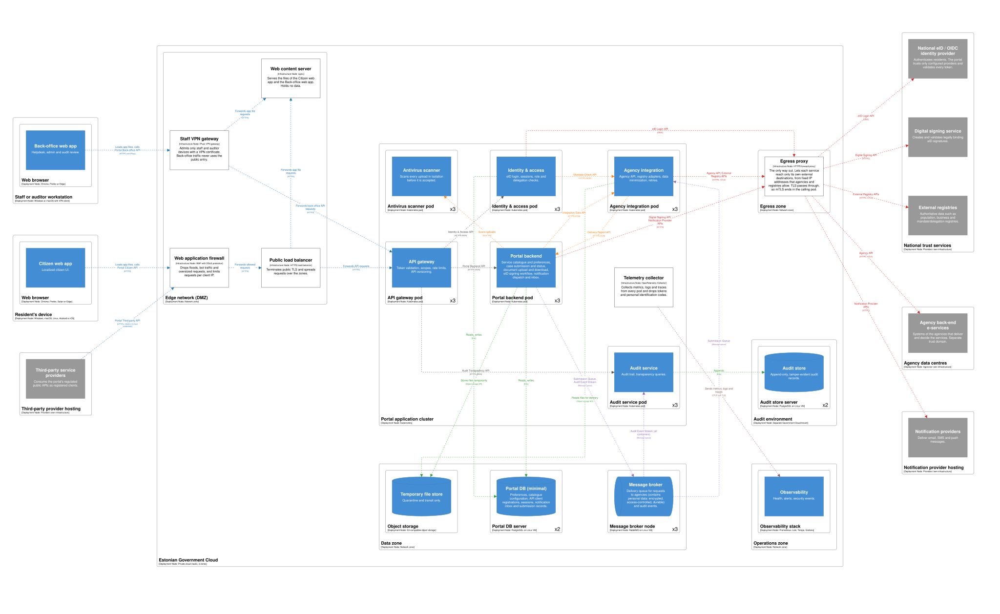
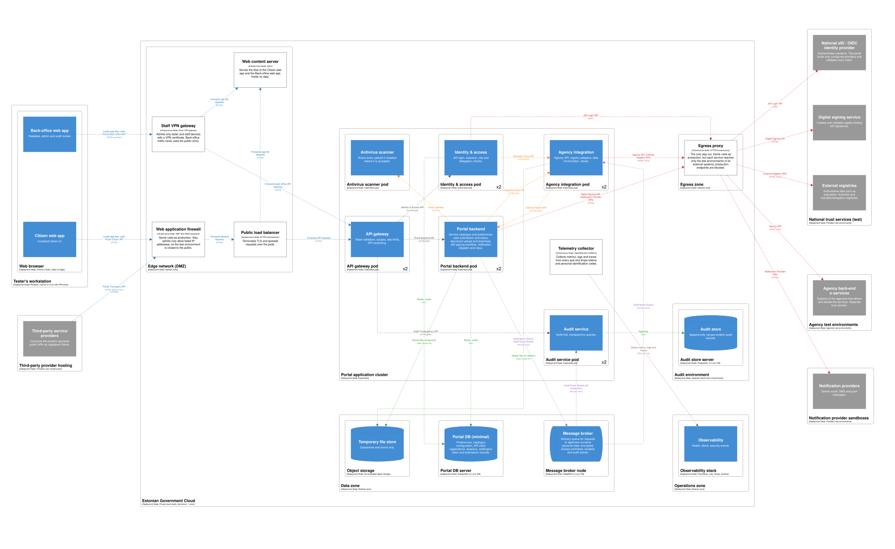
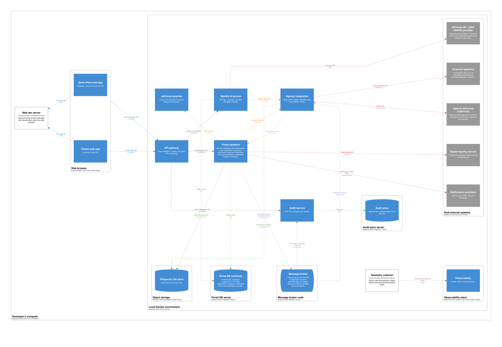

= Deployment Model

== 1. Environments

The portal runs in three deployment environments. A release moves from Development to Test to
Production.

[cols="2,3,3,3",options="header"]
|===
| |Development |Test (staging) |Production

|Purpose
|Write and debug code, and run the automated tests against stubs.
|Check a release and its integration with the external systems before it reaches production.
|Serve residents.

|Runs on
|One developer's computer, in Docker Compose.
|Estonian Government Cloud, in a separate test tenant, in one zone.
|Estonian Government Cloud, in three zones.

|Size
|Every container once.
|2 pods per service (1 for the Antivirus scanner); one node each for Portal DB, the Message broker and the Audit store.
|3 pods per service; Portal DB 2, Message broker 3, Audit store 2.

|Data
|Synthetic, from a seed script.
|Synthetic only, never a copy of production data.
|Real personal data.

|External systems
|Stubs on the same computer.
|The test environments of the providers.
|The real systems.

|Who reaches it
|The developer, on localhost.
|Testers and third-party test clients from allow-listed IP addresses; the back office through the Staff VPN gateway.
|Residents and third-party clients through the Web application firewall; staff and auditors through the Staff VPN gateway.
|===

The three diagrams share one key: link:../diagrams/c4_deployment_key.svg[c4_deployment_key.svg].
On each diagram, white boxes with rounded corners are deployment nodes (where something runs),
white boxes with square corners are infrastructure nodes, and xN is the number of instances of a
node. Blue lines enter the portal, red lines leave it, brown lines carry telemetry, and the other
colours are the calls between containers from the container diagram.

Sections 2-4 describe the same deployment nodes in each environment. Test and Development list only
how they differ from Production.

== 2. Production

Each trust boundary in link:trust_boundaries.adoc[trust_boundaries.adoc] is crossed in one place:
residents and third-party clients at the Web application firewall, staff and auditors at the Staff
VPN gateway, and external systems at the Egress proxy.

[cols="2,4,4",options="header"]
|===
|Deployment node |Production |Why

|Edge network (DMZ)
|Web application firewall, Public load balancer, Staff VPN gateway, Web content server.
|The only zone reachable from the internet, and it holds no personal data. The firewall drops floods and oversized requests before they reach the API gateway. Back-office traffic has its own entry, the VPN.

|Portal application cluster
|API gateway, Identity & access, Portal backend (with the outbox relay), Agency integration, Audit service, Antivirus scanner and Telemetry collector; 3 pods per service.
|One pod per zone, so losing a zone or a pod leaves every service running. Network policies allow only the calls on the container diagram, and each pod has its own mTLS service identity. The scanner runs on its own node pool with no outbound network access.

|Data zone
|Portal DB (primary and synchronous standby), Message broker (3 nodes), Temporary file store (replicated over the zones).
|Reachable only from the cluster. A confirmed request survives the loss of a zone: Portal DB has a synchronous standby and the broker keeps every message on three nodes. The Temporary file store is not backed up and deletes files after 7 days, so a deleted file leaves no copy.

|Egress zone
|Egress proxy.
|Each service may reach only its own external systems, from fixed IP addresses that agencies and registries can allow. TLS passes through the proxy, so mTLS with agencies and registries ends in Agency integration.

|Audit environment
|Audit store (primary and standby, write-once backups).
|A separate cloud tenant with its own administrators, so portal administrators cannot change or delete audit records. The Audit service may only insert.

|Operations zone
|Observability.
|Telemetry arrives through the Telemetry collector, which drops tokens and personal identification codes.
|===

== 3. Test (staging)

Test has the same zones, infrastructure nodes, technologies and security controls as production.

[cols="2,4,4",options="header"]
|===
|Deployment node |Test |Why

|Edge network (DMZ)
|Same as production; the firewall also admits only allow-listed IP addresses.
|Unreleased versions are closed to the public. Third-party providers test their API clients here.

|Portal application cluster
|2 small pods per service in one zone, no scaling out; 1 for the Antivirus scanner.
|Two is the fewest that still shows faults between instances, such as two outbox relays publishing the same row or a rolling update that drops requests. Losing a zone is not tested here.

|Data zone
|One small Portal DB instance, one Message broker node, Temporary file store not replicated.
|The test data can be recreated from seed scripts. The queues, per-queue permissions and the 7-day lifecycle rule are the same as in production, so they are tested.

|Egress zone
|Same rules, but each service reaches only the test environments of its external systems.
|Production endpoints are blocked, so a test never reaches a real agency or sends a message to a real resident.

|Audit environment
|One Audit store instance, no write-once backups.
|Still a separate tenant with insert-only access, so the separation is tested.

|Operations zone
|Same stack, small disks, short retention.
|Enough to debug a test run.
|===

== 4. Development

The whole portal runs on one developer's computer. Every port listens on localhost only, and the
computer holds no secrets of the test or production environment. Development has no network zones,
redundancy, firewall, VPN, egress rules or network policies; each row below shows what stands in for
that production node.

[cols="2,4,4",options="header"]
|===
|Deployment node |Development |Why

|Edge network (DMZ)
|Web dev server; no firewall, load balancer or VPN.
|Serves both web apps and reloads them when the code changes.

|Portal application cluster
|Local Docker environment (Docker Compose), each service once; no network policies.
|Services get certificates from a local development CA that exists only on this computer, so the checks on the caller's service identity run locally too.

|Data zone
|One container each for Portal DB, the Message broker and the Temporary file store, the same products as production.
|Portal DB is filled with synthetic data by a seed script. The Temporary file store keeps the 7-day lifecycle rule.

|Egress zone
|None; stub external systems on the same computer.
|Scripted answers stand in for the identity provider, signing service, registries, agencies and notification providers. No call leaves the computer and no real credentials are needed. A test can make a stub fail or answer late.

|Audit environment
|One Audit store container with its own server and credentials.
|The Audit service may only insert, as in production.

|Operations zone
|Observability stack in one container, optional.
|Telemetry passes the same Telemetry collector rules, so tokens and personal identification codes are dropped here too.
|===

== 5. Assumptions to confirm

* The portal runs in the Estonian Government Cloud (Riigipilv), so all data stays in Estonia. We assume three availability zones. With only two data centres, the broker quorum and the database failover need a witness in a third location.
* The technologies on the deployment nodes (Kubernetes, PostgreSQL, RabbitMQ, S3-compatible object storage, nginx, OpenTelemetry, Prometheus, Loki, Tempo, Grafana, Docker Compose) are working assumptions. The container diagram keeps generic technologies.
* Production instance counts are minimums. Peak capacity is sized once load estimates exist.
* Staff and auditors reach the Back-office web app only through the Staff VPN gateway. The public load balancer forwards only Citizen API and Third-party API routes.
* Service images are built once and promoted unchanged from Test to Production. Only configuration and secrets differ, and each environment has its own secrets.
* Test cannot show the loss of a zone or of a database or broker node. We assume Test can be scaled to the production counts for a failover or load test, from the same infrastructure code.
* The identity provider, signing service, registries and agencies offer test environments. A signing test environment may be hard to get; until then Test uses the stub from Development for that system.
